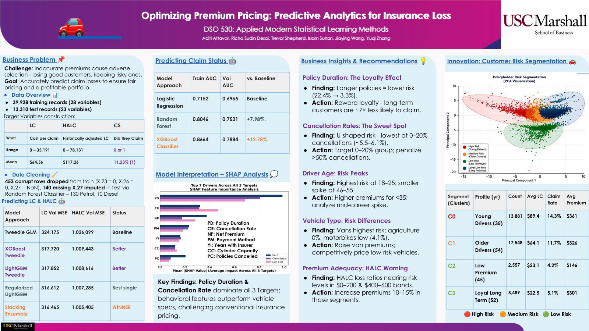
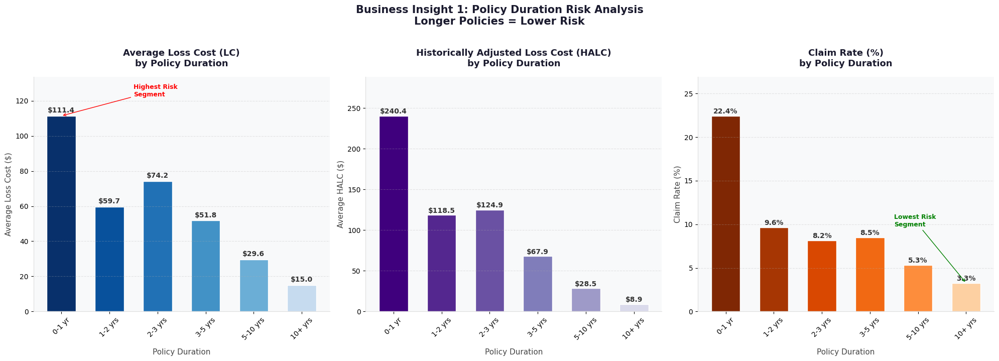
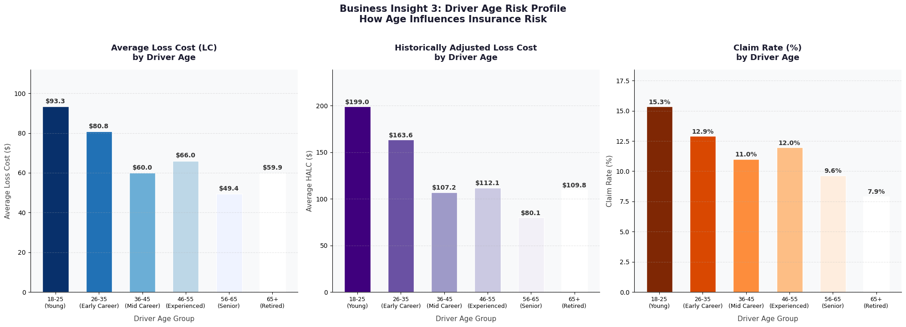
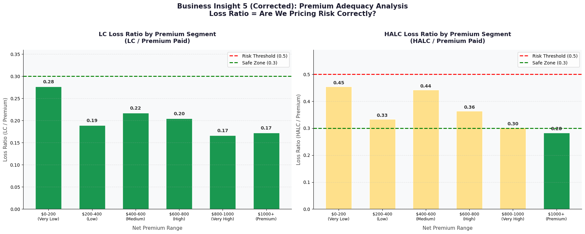
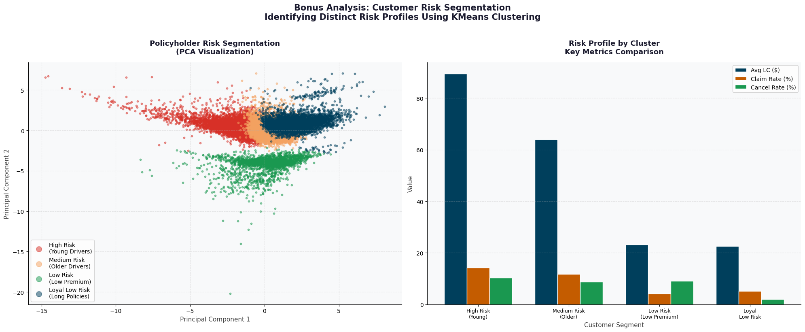
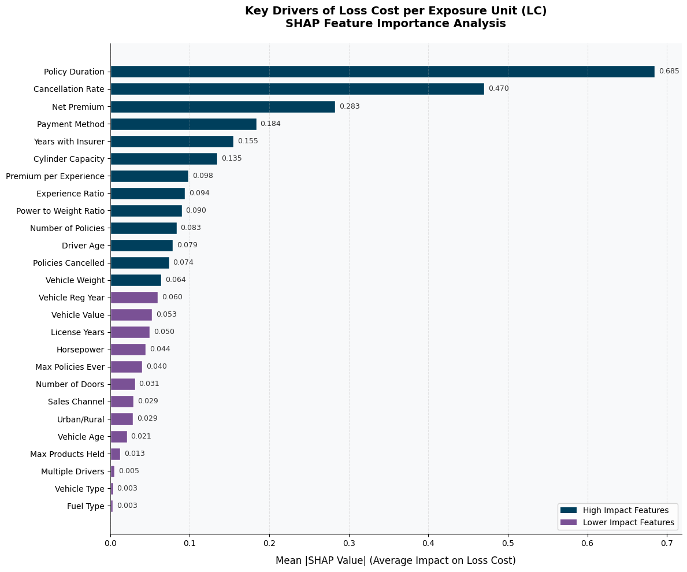
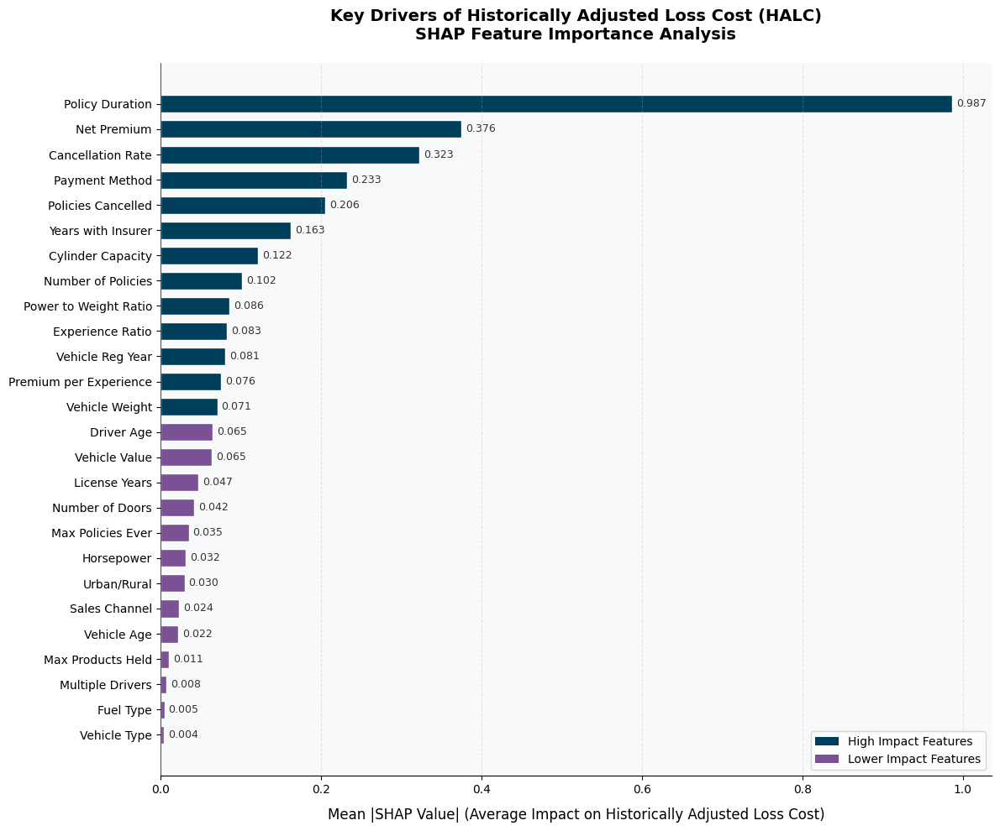
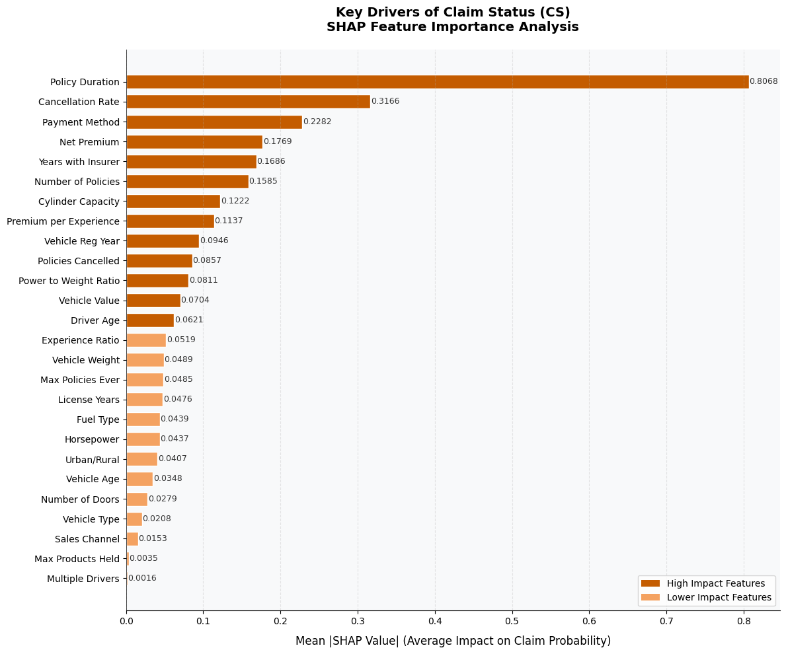

# Insurance Loss Analytics

Predicting how much an auto-insurance policy's claims will cost and whether it will claim at all, using nearly 40,000 policy records, to show an insurer where its pricing and underwriting carry the most risk.

**1st Place — USC Marshall MSBA Showcase, DSO 530: Applied Modern Statistical Learning Methods**

A six-person team project. We built Tweedie gradient-boosting models and a stacking ensemble for claim cost, an XGBoost classifier for claim likelihood, and used SHAP and customer segmentation to turn the models into pricing and retention insights.



*The poster as presented at the showcase ([PDF](reports/poster.pdf)). The poster and the [final report](reports/final_report.pdf) are the original submitted documents. They are kept as submitted. Where this README words a finding more carefully than they do, the README is the more considered statement.*

## At a glance

- **Tenure is the strongest risk signal.** Policies in their first year claim at 22.4%, against 3.3% for policies held ten years or more, and policy duration is the top driver in all three models.
- **Behavior outranks the vehicle.** Policy duration, cancellation history and premium matter more to the models than horsepower, weight or fuel type.
- **Two premium bands stand out for review.** The \$0–200 and \$400–600 bands have the highest historically adjusted losses relative to premium.
- **Four customer segments** with claim rates from 4.2% to 14.3% give a practical basis for differentiated pricing and retention.
- **Models:** a stacking ensemble gave the lowest error on claim cost, about 2% better than a GLM baseline, and an XGBoost classifier reached a ROC-AUC of 0.79 on claim status.

## Business problem

An insurer that prices policies inaccurately overcharges safe drivers and undercharges risky ones. The safe drivers move to competitors and the risky ones stay, a pattern called adverse selection, and the portfolio becomes less profitable over time. Pricing well depends on estimating each policy's expected losses.

The project set out to do two things:

1. Predict three quantities for every policy: the cost of its claims, that cost adjusted for claim history, and whether it claims at all.
2. Explain which customer and policy characteristics drive those predictions, so that the results can inform pricing, underwriting and retention decisions.

## Data

- **39,928 training policies** with 28 variables and **13,310 test policies** with 23 variables, provided by the course instructors. Column names are anonymized (`X.1`–`X.28`).
- **Most policies never claim.** Only 11.2% of training policies had a claim. Among those that did, costs are heavily right-skewed: the average loss cost across all policies is about \$65, and the largest is over \$35,000.
- Both files are in [`data/`](data/), with a data dictionary in [`data/README.md`](data/README.md).

The three prediction targets:

| Target | Plain-English meaning | Type |
|---|---|---|
| **LC** — loss cost | Average cost per claim on the policy; zero if there were no claims | Regression |
| **HALC** — historically adjusted loss cost | LC scaled by the policy's historical claim-rate factor | Regression |
| **CS** — claim status | Did the policy have at least one claim? | Classification |

The course materials, report and charts label LC "Loss Cost per Exposure Unit". As computed, it is total claim cost divided by number of claims.

## Approach

**Preparation.** 453 training rows with no fuel type and zero recorded horsepower were dropped (1.1% of the data). The same gap in 140 test rows was filled with a small Random Forest classifier, because test rows cannot be dropped. Dates were converted into driver age, years licensed and policy duration. The data was split 80/20 into training and validation sets.

**Why Tweedie models.** A target that is zero for almost 89% of policies and long-tailed for the rest is a poor fit for ordinary regression. The Tweedie family is designed for this shape, so every cost model uses a Tweedie objective.

**Model progression.**

| Step | What we did |
|---|---|
| Baseline | Tweedie GLM for cost; logistic regression for claim status |
| Tree models | XGBoost and LightGBM with Tweedie loss; Random Forest and XGBoost classifiers, all tuned by cross-validated grid search |
| Two-stage model | Predict whether a policy claims, then predict cost only for likely claimants. Tested and rejected (see Modeling results) |
| Feature engineering | Five added features: vehicle age, experience ratio, premium per year of experience, power-to-weight ratio and cancellation rate |
| Tuning | Searched the Tweedie variance power (best: 1.3 for LC, 1.4 for HALC) and regularized LightGBM after a larger model overfitted |
| Ensemble | Stacked LightGBM, XGBoost and Random Forest under a Ridge meta-model |

**Class imbalance.** The classifiers weight the rare "claim" class more heavily and are compared on ROC-AUC, not accuracy.

## Modeling results

### Claim cost (validation MSE; lower is better)

| Model | Features | LC | HALC |
|---|---|---|---|
| Tweedie GLM (baseline) | 21 | 324,174.59 | 1,026,098.61 |
| XGBoost Tweedie | 21 | 317,710.70 | 1,009,443.46 |
| LightGBM Tweedie | 21 | 317,852.36 | 1,008,615.96 |
| Regularized LightGBM | 26 | 316,611.59 | 1,007,284.58 |
| **Stacking ensemble (final)** | 26 | **316,465.41** | **1,005,405.23** |
| Two-stage model (rejected) | 21 | 360,421.99 | 1,197,159.79 |

### Claim status (validation ROC-AUC; higher is better)

| Model | Features | ROC-AUC |
|---|---|---|
| Logistic regression (baseline) | 21 | 0.6965 |
| Random Forest | 21 | 0.7521 |
| XGBoost, grid-searched | 21 | 0.7855 |
| **XGBoost, regularized (final)** | 26 | **0.7884** |

### How to read these numbers

- **The gains on cost are modest.** The stacking ensemble beats the GLM baseline by about 2.4% on LC and 2.0% on HALC, and beats the best single model by 0.05% and 0.19%. The models converge on a similar level of accuracy.
- **The comparison is not like-for-like.** The baselines used 21 features and the final models 26, so the improvement reflects both the models and the added features.
- **The two-stage model was clearly worse:** 13.4% higher MSE on LC and 18.7% on HALC than the single-stage models, so it was rejected.
- **The classifier gains are larger.** ROC-AUC rises from 0.70 for logistic regression to 0.79 for the final XGBoost.
- **For test predictions, the claim threshold was set to 0.71** so that the predicted claim rate (11.01%) matches the historical rate. It is not a cost-optimized threshold.

Because the cost models end up close together, most of the project's practical value is in what the models reveal about risk, covered in the sections that follow.

## Findings

These comparisons use the training data. They describe associations in this dataset and do not show cause and effect.

### Policy duration: newer policies carry far more risk



Policies in their first year have a claim rate of 22.4%, almost 7 times the 3.3% rate for policies held 10 years or more. Average cost falls broadly, though not at every step, as tenure increases.

### Cancellation history: a U-shape, not a straight line

| Cancellation rate | Claim rate | Policies |
|---|---|---|
| None | 13.1% | 25,516 |
| Very low | 5.5% | 2,244 |
| Low | 6.1% | 4,721 |
| Medium | 9.0% | 6,765 |
| High | 27.5% | 229 |

Customers with a few past cancellations have the lowest claim rates. Those with none sit higher, and the small group with a high cancellation rate is the riskiest, although with only 229 policies that estimate is less reliable.

### Driver age and vehicle type

- **Drivers aged 18–25** have the highest loss cost (\$93.3), HALC (\$199.0) and claim rate (15.3%), across 1,095 policies. Drivers aged 56–65 have the lowest loss cost (\$49.4). There is a small uptick at 46–55 compared with 36–45 (\$66.0 vs \$60.0).
- **Vans** have the highest claim rate (14.5%), ahead of passenger cars (11.4%) and motorbikes (4.1%). Agricultural vehicles show no claims, but across only 237 policies, which is too few to draw a conclusion.

<details>
<summary>Driver age chart</summary>



</details>

### Premium bands: where losses are high relative to price



Dividing average HALC by average premium within each band shows that the **\$0–200 and \$400–600 bands have the highest ratios (0.45 and 0.44, against 0.28–0.36 elsewhere)**. These are the first candidates for a pricing review.

Two notes on reading this chart:

- The dashed lines at 0.3 ("Safe Zone") and 0.5 ("Risk Threshold") and the green and yellow coloring were chosen by the team for illustration. They are not sourced industry benchmarks, so the bands should be compared with each other and not against those lines.
- The ratios are not true loss ratios. LC is the average cost per claim, not total losses, so the figures are useful for comparing bands and not as measures of profitability.

The "(Corrected)" in the chart title is from the original notebook, where this version replaced an earlier draft of the analysis.

### Customer segments (K-means)

K-means clustering with four clusters, chosen by the elbow method, groups policyholders into segments with distinct risk profiles.

| Segment | Policies | Claim rate | Avg LC | Avg premium | Avg driver age | Avg policy duration (days) |
|---|---|---|---|---|---|---|
| C0 — higher risk, younger | 13,881 | 14.3% | \$89.4 | \$361 | 35.4 | 948 |
| C1 — medium risk, older | 17,548 | 11.7% | \$64.1 | \$326 | 54.1 | 1,024 |
| C2 — low risk, low premium | 2,557 | 4.2% | \$23.1 | \$146 | 45.8 | 1,145 |
| C3 — low risk, long tenure | 5,489 | 5.1% | \$22.5 | \$301 | 52.1 | 3,822 |



C2 and C3 are both low-risk segments: C2 has the lower claim rate and their loss costs are about equal. C3 stands out for tenure, with an average policy duration of more than ten years, which matches the policy-duration finding above. The chart is titled "Bonus Analysis" because the segmentation was an extension beyond the core course requirements.

## Interpretability: what the models rely on (SHAP)

SHAP values measure how much each feature moves a model's predictions. They were computed on the regularized LightGBM models for LC and HALC and on the final XGBoost classifier for CS, not on the stacking ensemble.



- **Policy duration is the strongest driver for all three targets** (mean absolute SHAP of 0.685 for LC, 0.987 for HALC and 0.807 for CS).
- **Cancellation rate is second for LC and CS and third for HALC**, where net premium ranks second.
- **Behavioral and contractual features outrank vehicle specifications.** Vehicle type, fuel type and the multiple-drivers flag are among the least influential features.

The chart shows how strongly each feature matters, not in which direction. Direction comes from the segment findings above: for example, longer policy duration goes with lower risk.

<details>
<summary>SHAP charts for HALC and claim status</summary>





</details>

## Business applications

These follow the recommendations in the team's report. They are diagnostic: each one points to where an insurer should look more closely, and any pricing change would need actuarial and regulatory review first.

- **Use policy duration as a renewal and underwriting signal.** First-year policies warrant closer review, and long-tenure, low-risk customers are natural targets for retention offers.
- **Review customers with very high cancellation rates,** while recognizing that the group is small.
- **Look closely at pricing for younger drivers,** and investigate the 46–55 uptick with mileage or usage data if it becomes available.
- **Review van pricing.** Motorbikes show lower claim rates in this data; the agricultural sample is too small to act on.
- **Start any premium-adequacy review with the \$0–200 and \$400–600 bands.** The report and poster suggest a 10–15% increase for these bands. That figure was not derived from the analysis, so this README does not repeat it as a recommendation.
- **Use the segments to differentiate treatment:** pricing and underwriting review for C0, retention for C2 and C3.
- **Keep SHAP and the segment views alongside the predictions,** so that pricing decisions can be explained.

## Limitations

- **The notebook is a record of the original analysis, not a fully reproducible pipeline.**
  - *What is original:* the modeling code, the results and the saved outputs and charts, all from the team's run in Google Colab.
  - *What was cleaned up afterwards:* the explanatory text, the section structure, file paths, and the removal of Colab setup cells. No modeling code or output was changed.
  - *What is missing:* three definitions (the LC ensemble's base models, the premium-band table and the clustering feature list) and several imports are absent from the submitted file, so the notebook cannot be run from top to bottom. They have not been reconstructed, because the original code is not available and a rebuilt version could not be confirmed as the one that produced these results. Each affected cell is marked in the notebook.
  - *Environment:* the package versions used in Colab were not recorded. `requirements.txt` is a pinned environment recreated later for working with this repository, not the one used for the original run.
- **The validation split is random, not time-based,** so it does not test performance on future policies.
- **No exposure or mileage data,** which limits how well differences between segments can be explained.
- **Segment and cluster analyses are descriptive,** not causal.
- **The final models were trained on 80% of the training data** and not refitted on the full set.
- **The claim-status threshold matches the historical claim rate** and is not optimized for the cost of errors.
- **A few figures differ between documents.** This README uses the notebook's saved outputs. The report lists 1,018,744 for XGBoost HALC and 316,481 for regularized LightGBM LC, and the poster lists 317,720 for XGBoost LC; the notebook values are 1,009,443, 316,612 and 317,710.

**Next steps** identified in the report: a time-based holdout, exposure and mileage variables, calibration of the claim threshold, and a fairness review before any production use.

## Team and my contribution

DSO 530: Applied Modern Statistical Learning Methods, USC Marshall School of Business, May 2026.

**Team:** Trevor Shepherd, Yuqi Zhang, Richa Sudin Desai, Aditi Attavar, Jiaying Wang and Islam Sultan.

**My contribution:** data cleaning, analysis, and modeling. The report, poster and the rest of the work described here were produced by the team as a whole.

## Repository structure

```
Insurance-Loss-Analytics/
├── README.md
├── requirements.txt
├── notebooks/
│   └── insurance_loss_modeling.ipynb   # original project analysis with presentation/documentation cleanup
├── images/                             # charts from the original run, exported from the notebook's saved outputs
├── reports/
│   ├── final_report.pdf                # report as submitted, with student ID numbers removed
│   ├── poster.pdf                      # showcase poster, as presented
│   └── poster_preview.png
└── data/
    ├── README.md                       # data dictionary and cleaning notes
    ├── insurance_train2026.csv
    └── insurance_test2026.csv
```

The quickest way in is to open [the notebook](notebooks/insurance_loss_modeling.ipynb) on GitHub, where the outputs and charts from the original run are already rendered. To explore the code locally, create a Python 3.12 environment and run `pip install -r requirements.txt` (on macOS, XGBoost and LightGBM also need `brew install libomp`). This is a recreated environment, and the notebook does not run end to end; see Limitations.

## Tools

Python, pandas, NumPy, scikit-learn, XGBoost, LightGBM, SHAP, Matplotlib and seaborn.
